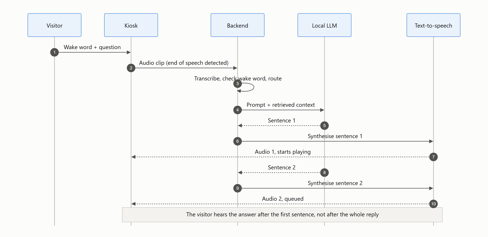
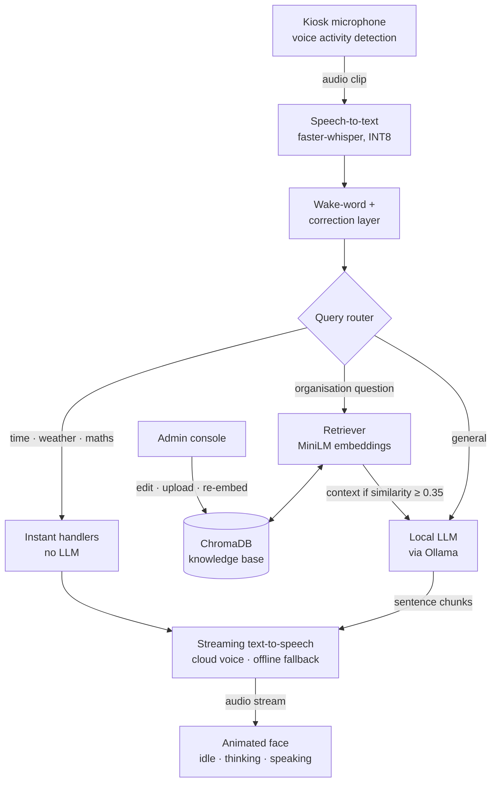

# VoiceDesk: AI Front-Desk Voice Assistant

A self-hosted, voice-driven receptionist kiosk. Visitors speak a question, and the assistant answers out loud from the organisation's own knowledge base, using local speech recognition, retrieval-augmented generation (RAG) and a locally served LLM.

> **Note:** The source code is private. This repository documents the architecture, design decisions and results. I'm happy to walk through the implementation in an interview.

<picture>
  <source media="(prefers-color-scheme: dark)" srcset="assets/streaming-dark.png">
  
</picture>

---

## Overview

Front desks at institutes and offices spend much of the day answering the same questions: courses, fees, timings, directions, who to meet. VoiceDesk handles these at a walk-up kiosk. A visitor says the wake word, asks a question in plain speech, and hears a spoken answer within seconds, while an animated face shows whether the assistant is listening, thinking or speaking.

Everything that touches visitor data runs on the kiosk itself: speech recognition, retrieval and the language model. Staff keep the answers current through an admin console, and their edits are searchable immediately, without a restart.

## Key Features

- **Wake-word voice conversation** with fuzzy phonetic matching, tuned on real transcription errors from the deployment site.
- **Grounded answers (RAG):** questions about the organisation are answered from an admin-editable knowledge base instead of the model's memory.
- **Streaming speech output:** the reply is spoken sentence by sentence while the LLM is still generating, so the visitor hears the start of the answer sooner.
- **Smart routing:** time, weather and arithmetic questions bypass the LLM entirely for instant answers. Organisation questions trigger retrieval, and everything else goes straight to the LLM.
- **Offline fallback:** if the internet drops, cloud text-to-speech automatically switches to an on-device voice.
- **Admin console:** edit the knowledge base, upload documents and monitor system health. Changes are re-embedded live.

## Architecture

## How It Works

1. The kiosk records the visitor and detects the end of speech using audio energy (voice activity detection).
2. The audio is transcribed locally with faster-whisper (INT8). A correction layer fixes known mis-hearings of the wake word and of domain terms.
3. A router decides how to answer: an instant handler, retrieval plus the LLM, or the LLM alone.
4. For organisation questions, the most relevant knowledge-base entries are retrieved from ChromaDB. Context is only passed to the model when its cosine similarity is at least 0.35, so weak matches don't mislead it.
5. The local LLM streams its answer, and each finished sentence is sent to text-to-speech straight away, so speech starts before generation ends.
6. The animated face changes state in step with the pipeline.

## Results

| Stage | Result |
|---|---|
| Speech-to-text (faster-whisper `tiny.en`, INT8) | ~200–400 ms to transcribe a 3 s clip; the 39 MB model loads in ~1 s |
| Text-to-speech (cloud neural voice) | ~200–400 ms per sentence, replacing an on-CPU TTS model that took 30+ s |
| Language model | ~1.2B-parameter instruction-tuned model, served locally with Ollama |
| Deployment | On-prem kiosk PC, CPU only (4-core Intel Core i5-7400) |

These timings are development notes recorded while tuning the kiosk, not results from a formal benchmark.

## Tech Stack

| Category | Tools |
|---|---|
| Speech-to-text | faster-whisper (CTranslate2, INT8), noise reduction, Butterworth filtering |
| Retrieval | sentence-transformers (all-MiniLM-L6-v2), ChromaDB (cosine HNSW) |
| LLM | Ollama, small instruction-tuned model (~1.2B parameters) |
| Text-to-speech | Edge-TTS with automatic pyttsx3/eSpeak offline fallback |
| Backend | FastAPI, Uvicorn, NDJSON streaming |
| Frontend | HTML, CSS, JavaScript, Web Audio (WAV encoding, voice activity detection) |

## Engineering Decisions

- **Self-hosted models:** visitor speech never leaves the building, and there are no per-request API costs for a kiosk that runs all day.
- **faster-whisper `tiny.en` for speech:** INT8 quantisation with CTranslate2 is fast on a CPU, the built-in VAD filter rejects silent audio, greedy decoding suits short phrases, and an English-only model is more accurate on wake words than a multilingual one.
- **Swapping the speech engine:** the first on-CPU text-to-speech model took 30+ seconds to respond. Cloud neural voices brought that to ~200–400 ms per sentence, and an on-device fallback keeps the kiosk talking when the internet drops.
- **Fixes driven by production logs:** the wake-word matcher and correction table were built from real failed transcripts at the deployment site, not guessed in advance. That made the biggest difference to reliability in a noisy lobby.
- **Streaming at sentence level:** waiting for the full LLM answer before speaking felt slow. Speaking each sentence as soon as it's finished cuts the perceived wait sharply without changing the model.
- **Bypassing the LLM where possible:** time, weather and arithmetic don't need a language model. Handling them directly is faster and avoids hallucinated answers.

## My Role

I built and deployed the full system: the speech pipeline and its field tuning, the RAG pipeline and knowledge-base admin tools, LLM integration and prompt design, streaming text-to-speech, and the kiosk interface.

## Contact

**Zayed Makandar** | [zayedmakandar03@gmail.com](mailto:zayedmakandar03@gmail.com) | [LinkedIn](https://www.linkedin.com/in/zayed-makandar-642536422/) | [Portfolio](https://zayedmakandar.com)
